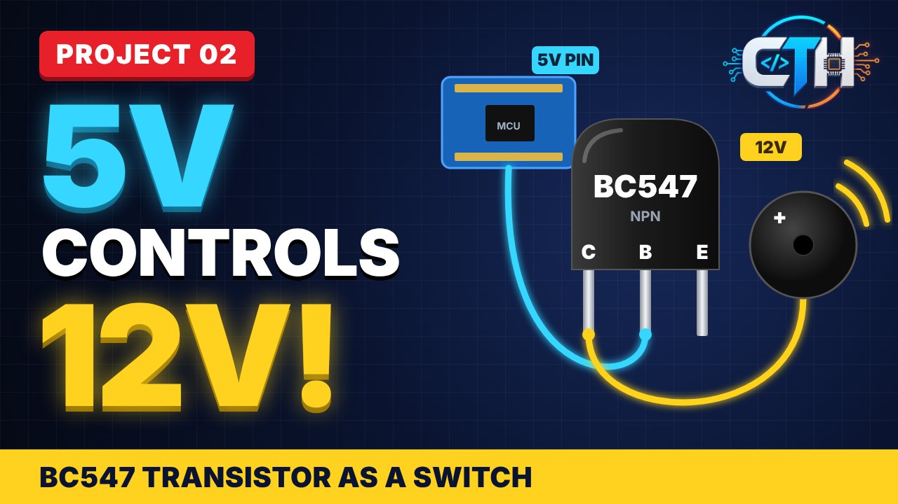
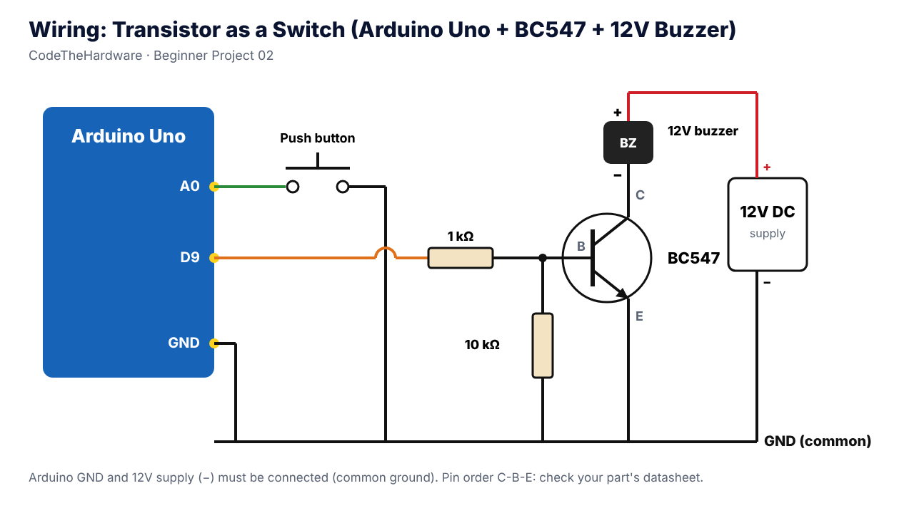

# Transistor as a Switch – Arduino Controls 12V Buzzer with BC547

**CodeTheHardware · Beginner Project 02**

A 5V Arduino pin cannot power a 12V buzzer directly. In this project a **BC547 NPN transistor** works as an electronic switch:
**press the button → buzzer ON, release → buzzer OFF.**

▶️ **Watch the video:** https://youtu.be/7pzKr06IQjM

---

## 🧰 Components

| Part | Qty |
|---|---|
| Arduino Uno | 1 |
| BC547 NPN transistor | 1 |
| 12V buzzer | 1 |
| 12V DC supply / adapter | 1 |
| Push button | 1 |
| 1 kΩ resistor | 1 |
| 10 kΩ resistor | 1 |
| Breadboard + jumper wires | – |

## 🔌 Wiring

| From | To |
|---|---|
| Push button | A0 ↔ GND (internal pull-up, no resistor needed) |
| D9 | 1 kΩ → BC547 **Base** |
| BC547 Base | 10 kΩ → GND |
| BC547 **Emitter** | GND |
| BC547 **Collector** | Buzzer (−) |
| Buzzer (+) | +12V |
| Arduino GND | 12V supply (−) — **common ground** |

> BC547 pinout (flat face toward you, legs down): **C – B – E**. Some manufacturers differ — check your part's datasheet.

## 💻 Code

Open [`transistor_switch/transistor_switch.ino`](transistor_switch/transistor_switch.ino) in Arduino IDE → select **Arduino Uno** → Upload.
Open Serial Monitor at **9600 baud** to see `Switch PRESSED -> Buzzer ON` / `Switch RELEASED -> Buzzer OFF`.

## ⚙️ How it works

- **Button pressed** → A0 reads LOW (INPUT_PULLUP) → D9 goes HIGH → base current flows → BC547 goes into **saturation** (fully ON) → 12V current flows through buzzer → collector → emitter → GND.
- **Button released** → D9 LOW → no base current → BC547 in **cut-off** (fully OFF) → buzzer OFF.
- The load current never flows through the Arduino pin — the pin only supplies a few mA of base current.

## 🧮 Base resistor calculation

Example: load current IC = 50 mA, forced β = 10 (so it saturates even with a low-gain part)

- IB = 50 mA / 10 = **5 mA**
- RB = (5 V − 0.7 V) / 5 mA ≈ **860 Ω** → use **1 kΩ** (≈ 4.3 mA)

Measure your buzzer's real current and keep BC547 under **100 mA**.

## 💡 Industry tips

1. **Don't drive loads from D13** — the Uno bootloader toggles D13 at reset, so the buzzer beeps for no reason.
2. **10 kΩ from base to GND** — during power-up/reset the pin is floating; this resistor keeps the transistor OFF.
3. **Relay or motor instead of buzzer?** Add a **1N4007 flyback diode** across the coil (stripe to +12V).

---

🔔 More embedded basics and projects: **[CodeTheHardware on YouTube](https://www.youtube.com/@CodeTheHardware)**
